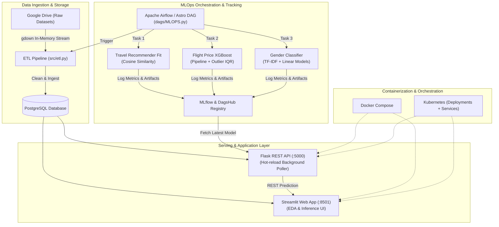

# ✈️ Voyage Analytics: Integrating MLOps in Travel Productionization

[](https://www.python.org/)
[](https://airflow.apache.org/)
[](https://mlflow.org/)
[](https://dagshub.com/)
[](https://www.docker.com/)
[](https://kubernetes.io/)
[](https://streamlit.io/)
[](https://flask.palletsprojects.com/)

**Voyage Analytics** is an end-to-end enterprise-grade MLOps platform engineered for the travel and aviation sector. It demonstrates the complete lifecycle of production machine learning systems—from raw data ingestion, automated ETL pipelines, distributed model training and tracking, to zero-downtime REST API model serving, interactive EDA intelligence dashboards, and cloud-native container orchestration via Kubernetes.

---

## 📑 Table of Contents

- [Architecture Overview](#-architecture-overview)
- [Key Features](#-key-features)
- [Project Directory Structure](#-project-directory-structure)
- [Machine Learning Pipelines](#-machine-learning-pipelines)
- [Data Pipeline & Orchestration (Airflow)](#-data-pipeline--orchestration-airflow)
- [API Reference (Flask Backend)](#-api-reference-flask-backend)
- [Streamlit Dashboard & UI](#-streamlit-dashboard--ui)
- [Deployment & Operations](#-deployment--operations)
  - [Prerequisites & Environment Setup](#prerequisites--environment-setup)
  - [Local Execution](#local-execution)
  - [Docker Compose Deployment](#docker-compose-deployment)
  - [Kubernetes (K8s) Deployment](#kubernetes-k8s-deployment)
- [Automated Testing](#-automated-testing)
- [Tech Stack](#-tech-stack)

---

## 🏛 Architecture Overview



---

## ✨ Key Features

1. **Automated End-to-End Orchestration**: Scheduled Airflow DAG (`voyage_folder`) managing dependencies across data ingestion, recommendation system fitting, flight pricing regressor training, and demographic classification.
2. **In-Memory Zero-Disk ETL**: Direct streaming of raw data from Google Drive to memory buffers (`io.BytesIO`) into PostgreSQL, preventing local disk pollution and IO bottlenecks.
3. **Continuous Model Registry & Hot-Reloading**:
   - Centralized experiment tracking and model registration using **MLflow** integrated with **DagsHub**.
   - Background polling daemon running in the Flask API that checks for newly approved models and updates the in-memory predictor dynamically without taking the service offline.
4. **Multi-Model Intelligence**:
   - **Flight Price Prediction**: Regressor using `XGBoost`, `RobustScaler`, IQR outlier clipping, and temporal/route feature engineering.
   - **Personalized Travel Recommendation**: Collaborative filtering & content ranking engine computing cosine similarity over user-destination visit matrices.
   - **Demographic & Gender Classification**: Text feature extraction via `TfidfVectorizer` and linear classification for passenger segmentation.
5. **Interactive Executive & Operational Dashboards**:
   - Comprehensive Exploratory Data Analysis (EDA) tabs covering flight distributions, hotel expenditures, and traveler profiles.
   - Live interactive inference forms with immediate prediction visual feedback.
6. **Production Containerization & Kubernetes Ready**: Complete configurations for multi-container Docker Compose and production Kubernetes manifests with `InitContainers` for graceful dependency ordering.

---

## 📂 Project Directory Structure

```plaintext
Voyage Analytics/
├── .astro/                         # Astro CLI runtime configuration
├── dags/                           # Airflow DAG definitions
│   └── MLOPS.py                    # Multi-stage ML pipeline orchestrator
├── dashboard/                      # Modular Streamlit EDA dashboards
│   ├── flight_dash.py              # Flight booking & route analytics
│   ├── hotel_dash.py               # Accommodation & duration analytics
│   └── user_dash.py                # Passenger demographic insights
├── data/                           # Local data caches & scratch storage
├── reports/                        # Analysis reports, plots, and figures
├── src/                            # Core source modules
│   ├── TravelRecommendation/       # Hotel recommendation ML engine
│   │   ├── recomm_pred.py          # Streamlit UI & inference functions
│   │   └── travelrecom.py          # Recommendation model & MLflow logging
│   ├── flightpriceprediction/      # Flight price forecasting engine
│   │   ├── app.py                  # Flask production inference API
│   │   ├── flightprice_pred.py     # Streamlit flight prediction module
│   │   └── trainflightmodel.py     # XGBoost training & metric tracking
│   ├── gender_Classification_model/# Demographic classifier
│   │   ├── gen_train.py            # Model training & MLflow tracker
│   │   └── gender_pred.py          # Prediction utilities & UI component
│   ├── config.py                   # App settings & configurations
│   ├── database.py                 # SQLAlchemy PostgreSQL engine & session pool
│   └── etl.py                      # In-memory ETL ingestion pipeline
├── streamlit/                      # Frontend web interface
│   └── streamlit_app.py            # Multi-page Streamlit application
├── tests/                          # Automated Pytest suite
│   ├── flightprice_test.py         # Flight pricing model tests
│   ├── recomm_test.py              # Recommender algorithm tests
│   └── test_app.py                 # Flask API endpoint verification
├── .env                            # Environment variables (DB, MLflow credentials)
├── .dockerignore                   # Docker build exclusions
├── Dockerfile                      # Astronomer Airflow runtime Dockerfile
├── Dockerfile.web                  # Web services (Flask & Streamlit) Dockerfile
├── docker-compose.yml              # Multi-container orchestration config
├── k8s-deployment.yaml             # Kubernetes Deployment & Service manifests
├── airflow_settings.yaml           # Local Airflow connection/pool overrides
├── packages.txt                    # System-level OS dependencies
└── requirements.txt                # Python package dependencies
```

---

## 🧠 Machine Learning Pipelines

### 1. Flight Price Prediction (`src/flightpriceprediction/`)
- **Objective**: Predict fare prices (`price`) based on origin, destination, agency, flight class, and departure date.
- **Preprocessing & Engineering**:
  - Outlier filtering using Interquartile Range (IQR).
  - Temporal decomposition: `day_of_week`, `is_weekend`, `month_num`, `quarter`.
  - Route interaction extraction: `route = from + " -> " + to`.
  - Normalization via `RobustScaler` and one-hot encoding for categorical attributes.
- **Algorithm**: `XGBRegressor` evaluated on $MAE$, $RMSE$, and $R^2$.
- **Tracking**: Logged to MLflow with artifact serializations (`flight_preprocess_pipeline` & `xgboost_flight_prediciton`).

### 2. Travel & Hotel Recommendation (`src/TravelRecommendation/`)
- **Objective**: Recommend travel destinations and lodging accommodations based on historical passenger behavior.
- **Algorithm**:
  - Generates cross-tabulation matrix of user stays vs. destinations.
  - Computes `cosine_similarity` across user vectors.
  - Combines collaborative similarity with hotel popularity scores to rank top-N accommodations.
- **Artifacts**: Packaged as custom `mlflow.pyfunc.PythonModel` for portability.

### 3. Passenger Gender Classification (`src/gender_Classification_model/`)
- **Objective**: Classify passenger profile segments for targeted personalized offers.
- **Pipeline**: Text vectorization via `TfidfVectorizer` paired with `LogisticRegression` and `LinearSVC`.
- **Metrics Tracked**: Accuracy, Precision, Recall, Macro ROC-AUC, PR-AUC, and Confusion Matrix.

---

## 🔄 Data Pipeline & Orchestration (Airflow)

The workflow orchestration is defined in [`dags/MLOPS.py`](file:///f:/Project/Labmantix/Voyage%20Analytics/dags/MLOPS.py) with DAG ID `voyage_folder`:

```plaintext
etl_task >> Travel_recom_task >> flight_price_task >> Gender_Classification_task
```

- **Schedule**: `@daily`
- **Execution Environment**: Astronomer Astro Runtime (`Dockerfile`) with isolated task execution via `PythonVirtualenvOperator` ensuring clean dependency boundaries between distinct models.
- **ETL Behavior**: Reads remote CSV streams, cleans invalid records and duplicate entries, and commits relational tables to PostgreSQL:
  - `flight`: Flight transactions, ticket prices, agencies, and dates.
  - `hotel`: Hotel reservations, duration, places, and total amounts.
  - `user_data`: User demographic data.

---

## 🌐 API Reference (Flask Backend)

The backend service runs on port `5000` via [`src/flightpriceprediction/app.py`](file:///f:/Project/Labmantix/Voyage%20Analytics/src/flightpriceprediction/app.py).

### Health Check
```http
GET /health
```
**Response (200 OK):**
```json
{
  "status": "ok",
  "model": "xgboost_flight_prediciton",
  "current_versions": {
    "flight_preprocess_pipeline": "1",
    "xgboost_flight_prediciton": "2"
  },
  "trained_on": "2026-09-26 14:30:00"
}
```

### Predict Flight Price
```http
POST /predict
Content-Type: application/json
```
**Request Body:**
```json
{
  "from": "Recife (PE)",
  "to": "Florianopolis (SC)",
  "flightType": "economic",
  "agency": "Gol",
  "date": "10/25/2026"
}
```

**Response (200 OK):**
```json
{
  "predicted_price": 745.20,
  "distance": 2680.0,
  "input": {
    "from": "Recife (PE)",
    "to": "Florianopolis (SC)",
    "flightType": "economic",
    "agency": "Gol",
    "date": "10/25/2026"
  }
}
```

---

## 📊 Streamlit Dashboard & UI

Launch the comprehensive frontend interface (`streamlit/streamlit_app.py`):

```bash
streamlit run streamlit/streamlit_app.py
```

### Dashboard Views:
1. **🏠 Overview**: High-level platform KPIs (Total flight records, traveler count, hotel stays, average ticket price, and market-dominant agencies) along with raw dataset samplers.
2. **📊 EDA Dashboard**:
   - **User Analytics**: Age distributions, gender distributions, and company correlations.
   - **Flight Analytics**: Popular routes, price volatility over time, agency market share.
   - **Hotel Analytics**: Average length of stay, total spend distributions, popular travel destinations.
3. **💰 Flight Price Prediction**: Interactive flight calculator connecting directly to the model pipeline.
4. **🚻 Gender Classification**: Inference tool testing demographic segmentation.
5. **🏨 Travel Recommendations**: Personalized hotel and destination recommender for registered user codes.

---

## 🚀 Deployment & Operations

### Prerequisites & Environment Setup

- Python 3.11+
- Docker Engine & Docker Compose
- Kubernetes CLI (`kubectl`) & Minikube/Cluster (optional for K8s deployment)
- Astro CLI (optional for local Airflow testing: `astro dev start`)

Create and configure your `.env` file in the root directory:

```env
DATABASE_URL=postgresql://<username>:<password>@<host>:<port>/<database>
MLFLOW_TRACKING_URI=https://dagshub.com/<username>/<repo>.mlflow
MLFLOW_TRACKING_USERNAME=<your_username>
MLFLOW_TRACKING_PASSWORD=<your_token>
DAGSHUB_USER_TOKEN=<your_dagshub_token>
```

---

### Local Execution

1. **Create virtual environment & install dependencies:**
   ```bash
   python -m venv venv
   # Linux/macOS:
   source venv/bin/activate
   # Windows:
   venv\Scripts\activate

   pip install -r requirements.txt
   ```

2. **Run Ingestion & Model Pipeline manually:**
   ```bash
   python -m src.etl
   python -m src.flightpriceprediction.trainflightmodel
   python -m src.TravelRecommendation.travelrecom
   python -m src.gender_Classification_model.gen_train
   ```

3. **Start Flask API:**
   ```bash
   python -m src.flightpriceprediction.app
   ```

4. **Start Streamlit Dashboard:**
   ```bash
   streamlit run streamlit/streamlit_app.py
   ```

---

### Docker Compose Deployment

Run the complete web architecture (Flask backend on `5000` + Streamlit frontend on `8501`):

```bash
docker-compose up --build
```

- Flask API endpoint: `http://localhost:5000`
- Streamlit Web Dashboard: `http://localhost:8501`

---

### Kubernetes (K8s) Deployment

The project provides production-grade declarative manifests in [`k8s-deployment.yaml`](file:///f:/Project/Labmantix/Voyage%20Analytics/k8s-deployment.yaml):

1. **Create Secret with Environment Variables:**
   ```bash
   kubectl create secret generic app-secrets \
     --from-literal=DATABASE_URL="your-db-url" \
     --from-literal=MLFLOW_TRACKING_URI="your-mlflow-uri" \
     --from-literal=MLFLOW_TRACKING_USERNAME="your-user" \
     --from-literal=MLFLOW_TRACKING_PASSWORD="your-pwd"
   ```

2. **Apply Deployments and Services:**
   ```bash
   kubectl apply -f k8s-deployment.yaml
   ```

3. **Verify Pod & Service Status:**
   ```bash
   kubectl get pods -l app=flask-backend
   kubectl get pods -l app=streamlit-frontend
   kubectl get svc
   ```

> [!NOTE]
> The Streamlit deployment features a lightweight `busybox` **initContainer** (`wait-for-flask`) that performs network checks until the Flask service is live before starting the frontend container.

---

## 🧪 Automated Testing

Run the test suite using `pytest`:

```bash
pytest tests/ -v
```

- `tests/test_app.py`: Validates Flask routes (`/health`, `/predict`), error handling, and payload schemas.
- `tests/flightprice_test.py`: Checks data preprocessing transformations, feature vector shape consistency, and regressor inference.
- `tests/recomm_test.py`: Validates recommendation matrix calculations and similarity bounds.

---

## 🛠 Tech Stack

| Domain | Technology / Library |
| :--- | :--- |
| **Language & Core** | Python 3.11 / 3.13 |
| **Machine Learning** | Scikit-Learn, XGBoost, Joblib, NumPy, Pandas |
| **MLOps & Tracking** | MLflow, DagsHub |
| **Orchestration** | Apache Airflow, Astronomer Runtime (`astro-cli`) |
| **Database & ORM** | PostgreSQL, SQLAlchemy, Psycopg2 |
| **API Serving** | Flask, Python-Dotenv |
| **Data Visualization & UI** | Streamlit, Plotly Express |
| **Containerization & Cloud** | Docker, Docker Compose, Kubernetes |
| **Quality Assurance** | Pytest, Flake8 |

---

## 📄 License

This project is licensed under the MIT License - see the repository LICENSE file for details.

